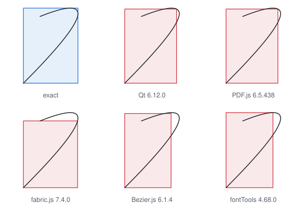

# bezier-bbox-audit

How 27 implementations compute the bounding box of a cubic Bézier segment, checked against exact arithmetic. Eighteen of them return a box that the curve leaves in at least one of three situations:

- the cubic is a quadratic segment in cubic form (11 libraries, including Qt, PDF.js and fabric.js);
- the coordinates are small, 10⁻⁴ or below (Two.js, AntV G, ZRender, and a few cases in inkex, svg-path-bbox and svg-path-commander);
- the curve is small compared with its distance from the origin, by a factor of 10⁸ (svgpathtools, svgelements, svg-path-bbox, svg-path-commander).



The curve is the quadratic segment (300000, 600000) (900000, 0) (400000, 200000), converted to a cubic in floating point. Qt's `quadTo`, opentype.js's `quadTo` and the path parsers of Snap.svg and Raphael do the same conversion internally, with the same outcome.

<!-- results:start -->
Boxes returned for the curve in the figure, as (xmin, ymin, xmax, ymax):

| | Box |
|---|---|
| exact | (300000, 150000, 627272.73, 600000) |
| beziers.py | (300000, 200000, 531250, 600000) |
| Raphael | (300000, 200000, 625000, 600000) |
| Bezier.js | (300000, 155555.56, 577777.78, 600000) |
| svg.path | (300000, 155555.56, 577777.78, 600000) |
| opentype.js | (300000, 200000, 625000, 600000) |
| svgpathtools | (300000, 200000, 627272.73, 600000) |
| Qt | (300000, 155555.56, 611111.11, 600000) |
| PDF.js | (300000, 155555.56, 611111.11, 600000) |
| fabric.js | (300000, 200000, 625000, 600000) |
| Snap.svg | (300000, 200000, 625000, 600000) |
| fontTools | (300000, 150000, 581250, 600000) |

## Results

Share of wrong boxes among 1000 curves per cell. A box is wrong when, along either axis, the curve extends beyond it by more than 0.1% of its extent along that axis. Libraries that are not listed in a table have no wrong boxes there.

Of the 59,763 wrong boxes for cubic input, 84% miss the curve by more than 1% of its extent and 56% by more than 10%; [results/RESULTS.md](results/RESULTS.md) has the numbers per library.

**Quadratic segments stored as cubics.** Columns: coordinates drawn from 0 to the given value.

| Library | Entry point | 10⁻⁶ | 10⁻⁴ | 10⁻² | 1 | 10² | 10⁴ | 10⁶ |
|---|---|---:|---:|---:|---:|---:|---:|---:|
| beziers.py | `CubicBezier.bounds` | 83% | 83% | 84% | 82% | 81% | 82% | 85% |
| Raphael | `Raphael.pathBBox` | 79% | 79% | 79% | 79% | 78% | 79% | 81% |
| Bezier.js | `Bezier.bbox` | 68% | 68% | 70% | 63% | 66% | 69% | 71% |
| svg.path | `CubicBezier.boundingbox` | 68% | 67% | 69% | 63% | 65% | 68% | 70% |
| opentype.js | `Path.getBoundingBox` | 60% | 63% | 66% | 59% | 61% | 62% | 63% |
| Two.js | `getCurveBoundingBox` | 88% | 89% | 0.8% | 0 | 0 | 0 | 0 |
| svgpathtools | `CubicBezier.bbox` | 0 | 0 | 0 | 0 | 0 | 50% | 79% |
| Qt | `QPainterPath.boundingRect` | 0 | 0 | 0 | 0 | 0 | 60% | 66% |
| PDF.js | `Util.bezierBoundingBox` | 0 | 0 | 0 | 0 | 0 | 61% | 64% |
| fabric.js | `util.getBoundsOfCurve` | 0 | 0 | 0 | 0 | 0 | 59% | 62% |
| Snap.svg | `Snap.path.getBBox` | 0 | 0 | 0 | 0 | 0 | 59% | 62% |
| AntV G | `cubicBox` | 88% | 0.3% | 0 | 0 | 0 | 0 | 0 |
| fontTools | `bezierTools.calcCubicBounds` | 0 | 0 | 0 | 0 | 0 | 0 | 54% |

**The same quadratics, passed to entry points that convert them to cubics internally.**

| Library | Entry point | 10⁻⁶ | 10⁻⁴ | 10⁻² | 1 | 10² | 10⁴ | 10⁶ |
|---|---|---:|---:|---:|---:|---:|---:|---:|
| Raphael | `Q path command` | 79% | 79% | 80% | 80% | 78% | 79% | 81% |
| Bezier.js | `Bezier.raise` | 68% | 67% | 70% | 64% | 65% | 68% | 72% |
| opentype.js | `Path.quadTo` | 59% | 62% | 63% | 58% | 60% | 60% | 62% |
| Snap.svg | `Q path command` | 0 | 0 | 0 | 0 | 0 | 57% | 63% |
| Qt | `QPainterPath.quadTo` | 0 | 0 | 0 | 0 | 0 | 56% | 63% |

**Glyph outlines.** Every quadratic segment of the simple glyphs of DejaVu Sans (48,404 segments, 1,023 of which turn around inside the segment, 2.1%) and DejaVu Sans Oblique (45,475 segments, 3,867 of which turn around inside the segment, 8.5%), in font units, from the files installed with matplotlib 3.11.2. Number of wrong boxes when the segment is stored as a cubic, and when it is passed as a quadratic to the entry points of the table above.

| Library | DejaVu Sans, as cubics | DejaVu Sans Oblique, as cubics | DejaVu Sans, as quadratics | DejaVu Sans Oblique, as quadratics |
|---|---:|---:|---:|---:|
| Raphael | 229 | 1815 | 226 | 1885 |
| beziers.py | 259 | 2015 |  |  |
| Bezier.js | 59 | 824 | 64 | 826 |
| svg.path | 57 | 834 |  |  |
| opentype.js | 11 | 274 | 19 | 218 |
| PDF.js | 0 | 13 |  |  |
| Snap.svg | 0 | 3 | 0 | 7 |
| Qt | 0 | 3 | 0 | 0 |
| fabric.js | 0 | 3 |  |  |

**Random cubics.** Columns: coordinates drawn from 0 to the given value.

| Library | Entry point | 10⁻⁶ | 10⁻⁴ | 10⁻² | 1 | 10² | 10⁴ | 10⁶ |
|---|---|---:|---:|---:|---:|---:|---:|---:|
| Two.js | `getCurveBoundingBox` | 90% | 90% | 0.4% | 0 | 0 | 0 | 0 |
| AntV G | `cubicBox` | 90% | 89% | 0.5% | 0 | 0 | 0 | 0 |
| ZRender | `bbox.fromCubic` | 90% | 8.5% | 0 | 0 | 0 | 0 | 0 |
| svg-path-bbox | `svgPathBbox` | 0.2% | 0 | 0 | 0 | 0 | 0 | 0 |
| svg-path-commander | `getPathBBox` | 0.2% | 0 | 0 | 0 | 0 | 0 | 0 |

**Random cubics from the unit square, moved away from the origin.** Columns: the distance moved along each axis.

| Library | Entry point | 1 | 10² | 10⁴ | 10⁶ | 10⁸ | 10¹⁰ |
|---|---|---:|---:|---:|---:|---:|---:|
| svg-path-bbox | `svgPathBbox` | 0 | 0 | 0 | 0.8% | 90% | 90% |
| svg-path-commander | `getPathBBox` | 0 | 0 | 0 | 0.8% | 90% | 90% |
| svgpathtools | `CubicBezier.bbox` | 0 | 0 | 0 | 0.8% | 90% | 90% |
| svgelements | `CubicBezier.bbox` | 0 | 0 | 0 | 0.8% | 90% | 90% |

Wrong boxes only among the symmetric arches, which are tabulated in [results/RESULTS.md](results/RESULTS.md): inkex.

No wrong boxes anywhere in the corpus: matplotlib, kurbo, Skia, cairo, Core Graphics, Paper.js, Konva, thi.ng/geom-splines, OpenJDK.
<!-- results:end -->

## Cause

The box needs the parameters where a coordinate turns around. They are the roots of a quadratic *a t² + b t + c* whose coefficients come from the control points. Three things go wrong, all of them in how that quadratic is solved.

**The leading coefficient is rounding error.** For a quadratic segment *a* is zero; computed in floating point it is not. The textbook formula (−b ± √(b² − 4ac)) / 2a then yields one root as a difference of nearly equal numbers divided by that rounding error, and the extremum is lost. Libraries try to catch the case first:

| Test before the formula | Libraries | Fails |
|---|---|---|
| `a == 0` | svg.path, opentype.js, Bezier.js, beziers.py | at every coordinate range |
| none | Raphael | at every coordinate range |
| `abs(a) < 1e-12` | Qt, PDF.js, fabric.js, Snap.svg, svgpathtools | for coordinates between 10² and 10⁴ and above |
| `abs(a) < 1e-10` | fontTools | for coordinates between 10⁴ and 10⁶ and above |

**The tolerance is too large.** The same kind of test with a larger constant treats a genuine cubic as degenerate when its coordinates are small: `abs(a) < 0.001` in Two.js, `1e-5` in AntV G, `1e-8` on the discriminant in ZRender. Every fixed tolerance has such a range, including the ones in the table above; it is a matter of where. This is also why Two.js and AntV G appear among the converted quadratics at small ranges.

**The discriminant is formed from coordinates.** svgpathtools, svgelements, svg-path-bbox and svg-path-commander expand the discriminant into products of the control values. Far from the origin these products are huge and their difference is lost.

Source locations and the error analysis are in [docs/note.md](docs/note.md).

## Fix

No tolerance is needed. Work with differences of the control values, form the sum that cannot cancel, and take the other root from the product of the roots:

```python
d0, d1, d2 = p1 - p0, p2 - p1, p3 - p2
a, h, c = d0 - 2 * d1 + d2, d1 - d0, d0       # a t^2 + 2 h t + c
q = -(h + copysign(sqrt(h * h - a * c), h))
roots = q / a, c / q                           # skip a division by zero
```

When *a* is exactly zero, *c / q* is the root of the remaining linear equation; when *a* is rounding error, *q / a* is huge and discarded, and *c / q* is still correct. Skia and Paper.js solve the quadratic this way.

[reference/cubic_bounds.py](reference/cubic_bounds.py) and [reference/cubic_bounds.mjs](reference/cubic_bounds.mjs) are complete implementations of about thirty lines. Against the exact reference their error stays within 16 units in the last place of the largest coordinate on the whole corpus and on further families from coordinates of 10⁻³⁰⁰ to 10³⁰⁰, and the two return bit-identical results. The tests assert both.

## Reproducing

```sh
pip install -r requirements.txt pytest    # libraries under test
npm ci
python -m audit.run       # every library over the corpus -> results/results.json
python -m audit.report    # tables in this file and results/RESULTS.md
pytest                    # exact reference, floating-point reference, measuring code
python repro/python.py    # one minimal case per library, for the first situation
node repro/javascript.mjs
```

Libraries that are not installed are skipped; `python -m audit.run --check` compares a run with the recorded counts instead and fails if a library is missing. The OpenJDK run needs `java` 11 or later; Core Graphics is tested on macOS only. The corpus is generated from a fixed seed and its SHA-256 is recorded with the results. CI reruns the audit on Linux and compares the counts with the recorded ones, which are from macOS on arm64. They are identical except for Qt, where a cell differs by at most 9 curves in 1000, and for svg.path on the glyph outlines, by 2 segments.

## Scope

- Apart from the outlines of two fonts, the corpus is synthetic; the rates are not estimates of how often real files are affected. The first situation arises whenever a quadratic is converted in memory. The other two need coordinates that are unusual for drawings: values of 10⁻⁴ and below, or a curve 10⁸ times smaller than its coordinates.
- Font outlines often have on-curve points at their extrema, and such segments have no interior extremum to miss. The glyph table shows how many segments of the two fonts do have one. Other fonts and other kinds of documents were not examined.
- Only the box of a single segment is examined, at the versions listed in [results/RESULTS.md](results/RESULTS.md). What a library does with a wrong box (hit testing, culling, layout, export) is not.
- "No wrong boxes" means none in this corpus. A box counts as wrong only when it excludes part of the curve; boxes that are too large are recorded separately in the same file, and AntV G, svg-path-bbox and svg-path-commander return some.
- The counts do not depend on the exact reference: recounting against points of each curve evaluated in floating point gives the same totals.
- The eighteen libraries share code. fabric.js, Snap.svg and Two.js contain the same routine with different tolerances, and PDF.js's is derived from Snap.svg's according to its source; svgelements credits svgpathtools; svg-path-commander has the routine of svg-path-bbox.
- Native libraries were called through Python bindings (PySide6, skia-python, pycairo, kurbopy, PyObjC). Misses within a library's coordinate resolution are not counted: 1/256 for cairo's fixed point, 2⁻²⁰ of the largest coordinate for Skia's single precision. cairo is not given coordinates beyond its range of 2²³.
- The tested packages were the latest releases on PyPI and npm on 2026-11-17, and for the eleven libraries of the first situation the same code was on each project's default branch that day. A keyword search of their trackers found no report of the problem; it was not exhaustive. Nothing has been reported upstream yet.

## References

- W. H. Press, S. A. Teukolsky, W. T. Vetterling, B. P. Flannery. *Numerical Recipes*, 3rd ed., §5.6, "Quadratic and Cubic Equations".
- D. Goldberg. [What Every Computer Scientist Should Know About Floating-Point Arithmetic](https://doi.org/10.1145/103162.103163). *ACM Computing Surveys* 23(1), 1991.
- Skia, [`SkFindUnitQuadRoots`](https://github.com/google/skia/blob/main/src/core/SkGeometry.cpp), which cites the formula from *Numerical Recipes*.
- OpenJDK, [JDK-8176501](https://bugs.openjdk.org/browse/JDK-8176501), where the near-zero leading coefficient was discussed when `getBounds2D` was made tight.

## License

MIT
